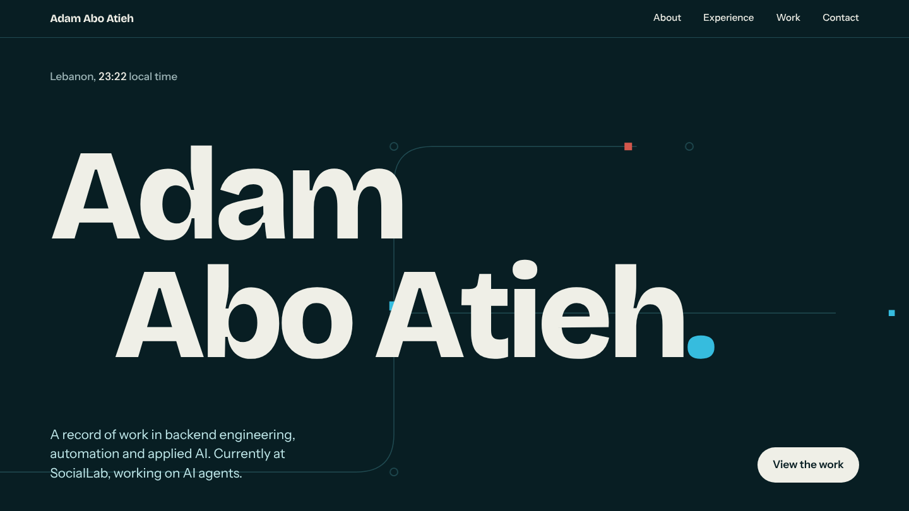

# Adam Abo Atieh

I build backend systems and work with AI models, running them and measuring how they behave. What I enjoy most is understanding how the pieces connect. I want to keep going deeper into AI.

Based in Lebanon. BSc in Computer Science, Lebanese International University (2022 to 2026).

Portfolio: [adamaboatieh.com](https://adamaboatieh.com/)

[](https://adamaboatieh.com/)

## Projects

| Project | What it is | Built with |
|---|---|---|
| [CHIA Edge Tutor](https://github.com/SocialLab-AI/CHIA-Project) | SocialLab team project. Hackathon experiments comparing Gemini-guided optimization with random search over one hardware and software design space, scored on answer quality, latency and estimated cache energy. My part connected native Qwen evaluation with a gem5 RISC-V attention proxy. | Python, llama.cpp, Qwen, Ray, gem5, Docker |
| [Smart Helmet Backend](https://github.com/adamaboatieh/smart_helmet_backend) | Final year project. A real-time backend for a motorcycle safety helmet prototype: validated telemetry intake, queued persistence, authenticated WebSocket streaming, and risk and crash-model logic behind trip and alert workflows. | Python, FastAPI, Pydantic, WebSockets, SQLAlchemy |
| [Smart Helmet anomaly detection](https://github.com/adamaboatieh/Machine-Learning-Project) | The machine learning side of the helmet. Unsupervised crash and anomaly detection on sensor data, with Isolation Forest chosen over One-Class SVM and LOF. | Python, scikit-learn, pandas |
| [Post-quantum secure AI agent](https://github.com/adamaboatieh/Post-Quantum-Secure-AI-Agent) | Research prototype that signs AI-agent tool actions with Ed25519 or ML-DSA-44, with authorization, freshness and replay checks, attack experiments and benchmarks. | Python, cryptography, Gemini API, SQLite |
| [Discord Instructor Workspace](https://github.com/adamaboatieh/Discord-Activity-Intelligence-Bot) | A Discord bot and web dashboard for running class sessions: voice session recording, attendance and participation tracking, scheduling, and per-session reports. | Node.js, Discord.js, SQLite, Next.js, TypeScript |
| [Velora e-commerce platform](https://github.com/adamaboatieh/Ecommerce-Django-Website) | Storefront with JWT login, email verification, a persistent cart, and checkout with stock validation. | React, TypeScript, Django REST Framework |

## Tools I work with

**Languages:** Python, JavaScript, TypeScript, SQL

**Backend and web:** FastAPI, Flask, Django, Node.js, Express, React, Next.js, SQLAlchemy

**AI and systems:** llama.cpp, Qwen, model evaluation, Ray, gem5

**Data and infrastructure:** SQLite, MongoDB, MySQL, Linux, Docker, Git, Selenium

## About this repository

This repository holds my portfolio site. It is plain HTML, CSS and JavaScript with no framework, no build step and no third-party requests: the fonts and images are in the repository.

```
index.html          page content, SEO tags and structured data
styles.css          layout, colour and animation
motion.js           scroll effects, the live clock and the project sketches
404.html            page shown for a wrong address
assets/             portrait, event photos, fonts and the link-preview image
robots.txt          tells search engines the site may be indexed
sitemap.xml         list of pages for search engines
llms.txt            plain-text summary for AI assistants
site.webmanifest    name, colours and icons for browsers
favicon.ico, favicon-32.png, favicon-192.png, apple-touch-icon.png
wrangler.jsonc      Cloudflare deployment settings
.assetsignore       files Cloudflare should not publish
_headers            security and caching headers for Cloudflare
preview.png         the screenshot shown above
```

### Run it locally

Open `index.html` in a browser. Nothing needs installing.

### Publish it on adamaboatieh.com with Cloudflare

The repository includes `wrangler.jsonc`, which tells Cloudflare to serve this folder as a static site.

1. In the Cloudflare dashboard, create a Workers application and connect this GitHub repository.
2. Leave the build command empty and keep the deploy command as `npx wrangler deploy`.
3. After the first deploy, open the Worker's **Settings**, then **Domains & Routes**, and add `adamaboatieh.com` as a custom domain.

Every push to `main` then redeploys the site. `.assetsignore` keeps repository-only files such as this README out of the published site, and `_headers` sets the security and caching headers.

### After it is live

- Add the site in [Google Search Console](https://search.google.com/search-console) and submit `https://adamaboatieh.com/sitemap.xml`.
- When the content changes, update the `lastmod` date in `sitemap.xml`.

### Notes on the design

- Animations switch off for visitors who have reduced motion turned on, and pause while off screen.
- The page works without JavaScript; only the motion and the live clock are lost.
- A content security policy in the page allows only the site's own scripts, styles, fonts and images.
- The moving sketches beside each project illustrate how the system works. They are not recorded data.

## Say hi

- Email: [me@adamaboatieh.com](mailto:me@adamaboatieh.com)
- LinkedIn: [adam-abo-atieh](https://www.linkedin.com/in/adam-abo-atieh/)
